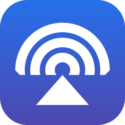
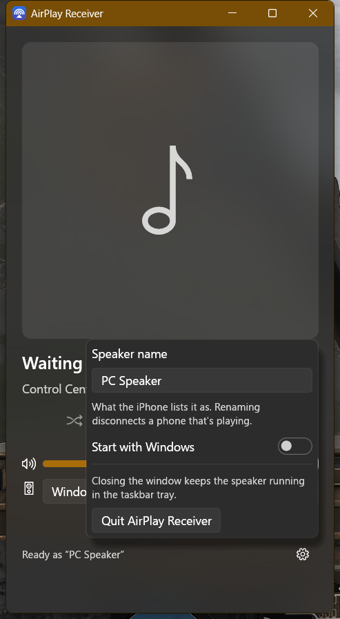

<div align="center">



# AirPlay Receiver

**Turn a Windows PC into an AirPlay speaker. Your iPhone sees it in Control Center, with nothing to install on the phone.**

[](#)
[](src/main.rs)
[](LICENSE)

[Download](../../releases/latest) · [Quick start](#quick-start) · [Good to know](#good-to-know) · [Build it yourself](#build-it-yourself)



</div>

## What it does

- **Shows what's playing:** title, artist, album, artwork and track position.
- **Controls the phone:** play, pause, next, previous, shuffle and a seek bar, from the PC.
- **Plays where you want:** pick any Windows sound output in the app, or leave it on the Windows default and use the Windows volume mixer.
- **One volume:** the phone's slider, the app's slider and the output you picked move together, in both directions.
- **Stays out of the way:** closing the window leaves it in the taskbar tray. Started with Windows it uses about 18 MB of memory and no measurable CPU. It only opens the sound device while something is playing.
- **Looks like Windows 11:** follows your light or dark mode and accent color, with the acrylic background.

## Quick start

1. Download `AirPlayReceiver.exe` from [Releases](../../releases/latest) and double-click it. It's one file with nothing to install. The exe isn't signed, so SmartScreen may warn you: choose **More info**, then **Run anyway**.
2. When Windows Firewall asks, click **Allow**. The phone can't reach it otherwise.
3. On your iPhone, with both on the same network, open **Control Center**, tap **AirPlay** and pick **PC Speaker**.

The gear icon in the corner lets you rename the speaker, turn on **Start with Windows** and quit. Running the exe again just opens the window of the copy already running.

## Good to know

- **It's AirPlay 1, on purpose.** It's the only version that lets a third-party speaker send play, pause and skip back to the phone. That means no multi-room grouping with HomePods, and the usual AirPlay 1 delay of about 2 seconds. It's audio only, with no screen mirroring.
- **There's no password.** Anyone on your network can play to it.
- **What the volume moves:** with an output picked in the app, that output's own Windows level. On **Windows default**, only this app's slider in the Windows mixer. It never touches the main Windows volume. Connecting doesn't change the PC's volume either, so a phone left at full volume can't blast anything.
- **VB-Audio virtual devices** (VB-Cable, Matrix and so on) ignore the Windows volume: the sound measured the same at 100% and 25%. So on those the app applies the volume to the sound itself as well. Other virtual drivers haven't been measured.
- **A device another app holds in exclusive mode** can't be opened. The app says so, plays on the Windows default and switches back when the device frees up.
- **A renamed speaker counts as a new speaker** to the phone, so it may forget the volume it remembered.

**What's been tested:** an iPhone and iTunes for Windows, on Windows 11. On the iPhone that covers discovery, audio, track info, artwork, play, pause, volume both ways and the output picker. **Next, shuffle and the seek bar haven't been tried on an iPhone yet**, and Windows 10 is untested. If one doesn't work for you, `%APPDATA%\AirPlay Receiver\log.txt` records every command with the phone's reply.

## Build it yourself

Only if you want to change the code. Running the app needs none of this. You need [Rust](https://rustup.rs) and the Visual Studio C++ build tools.

```
cargo build --release
```

The exe lands in `target\release\AirPlayReceiver.exe`. `update.ps1` rebuilds and restarts it in one step.

```
cargo test --release
```

`cargo test --release -- --ignored` adds checks against your real sound devices and registry. They're silent or nearly so and put everything back. One needs VB-Cable and ffmpeg.

Settings are in `%APPDATA%\AirPlay Receiver\settings.txt`, including `delay_ms` if you need to adjust the audio delay.

## Credits and license

Licensed under the [GPL-3.0](LICENSE). The AirPlay engine is a modified copy of [shairplay-rust](https://github.com/metaneutrons/shairplay-rust) by Fabian Schmieder, under its own license. [`vendor/README.md`](vendor/README.md) lists what changed and why.

Not affiliated with or endorsed by Apple. AirPlay and iPhone are trademarks of Apple Inc.
